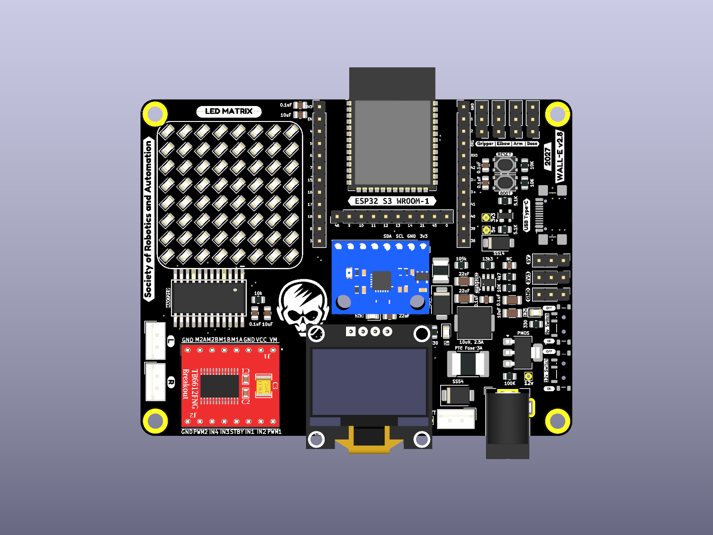
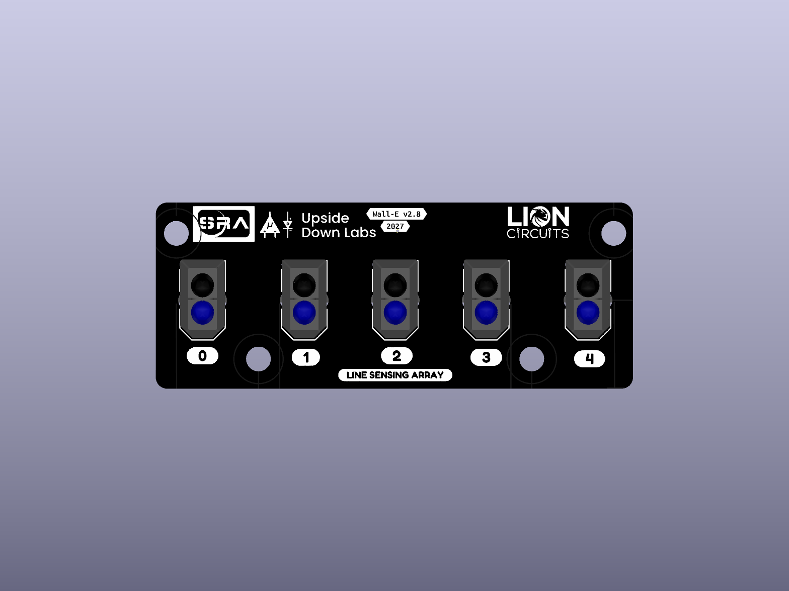
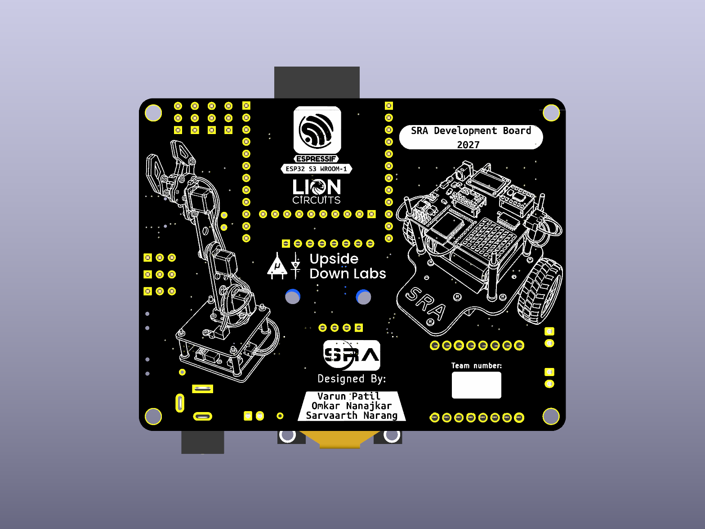
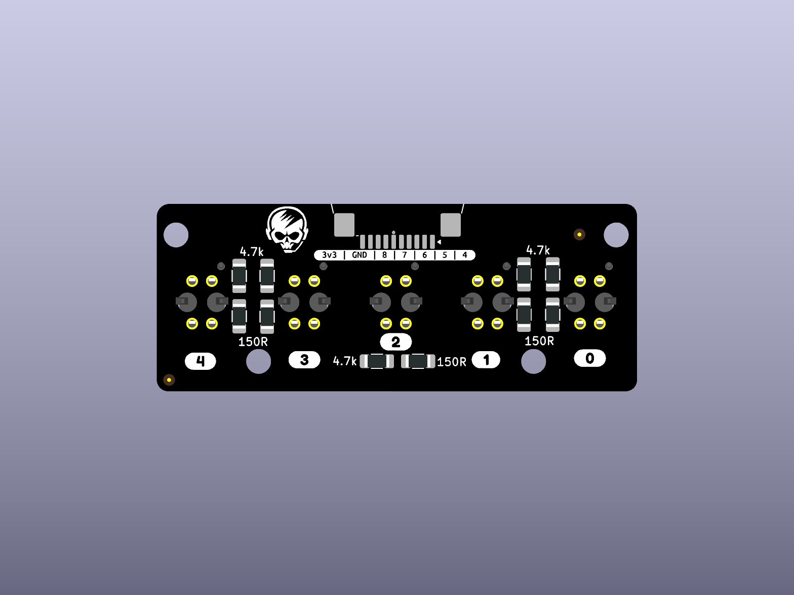

# 2027 mechanical models

## Board views

| View | SRA controller | Line sensor array |
| --- | --- | --- |
| Top / front |  |  |
| Bottom / back |  |  |

| File | Purpose |
| --- | --- |
| [sra_board_2027.step](sra_board_2027.step) | SRA board assembly exported from the checked-in PCB |
| [lsa_board_2027.step](lsa_board_2027.step) | LSA board assembly exported from the checked-in PCB |
| [sra_board_2027_front.png](sra_board_2027_front.png) | Orthographic KiCad 3D render of the SRA top / front |
| [sra_board_2027_back.png](sra_board_2027_back.png) | Orthographic KiCad 3D render of the SRA bottom / back |
| [lsa_board_2027_front.png](lsa_board_2027_front.png) | Orthographic KiCad 3D render of the LSA top / front |
| [lsa_board_2027_back.png](lsa_board_2027_back.png) | Orthographic KiCad 3D render of the LSA bottom / back |
| [components/](components/) | Board-specific STEP/STP component models used by the KiCad layouts |
