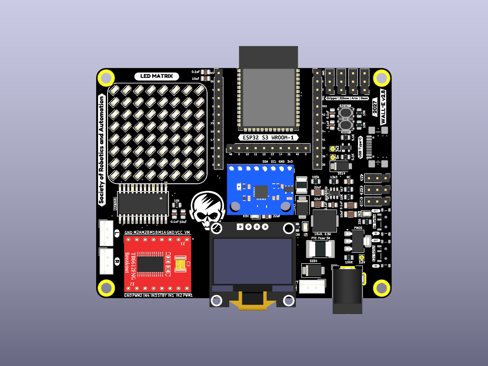
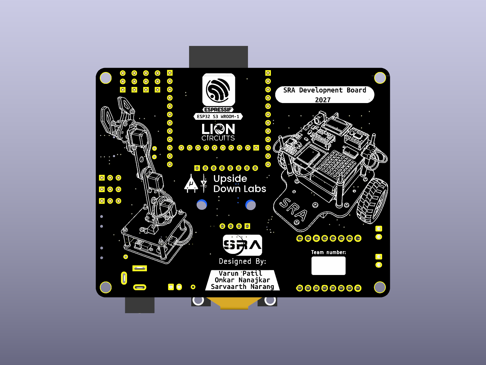
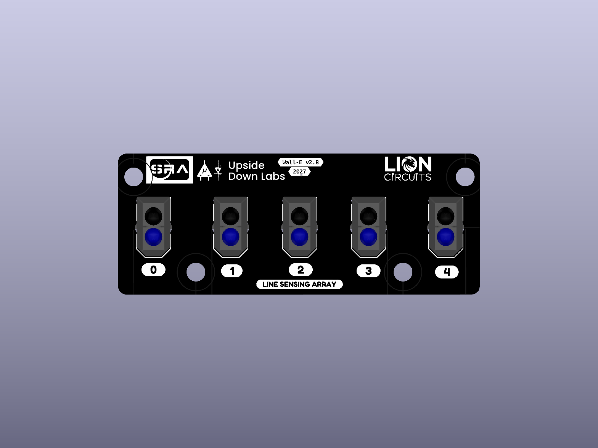
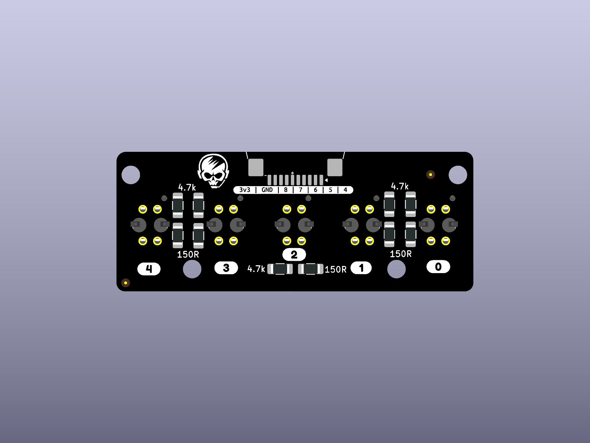
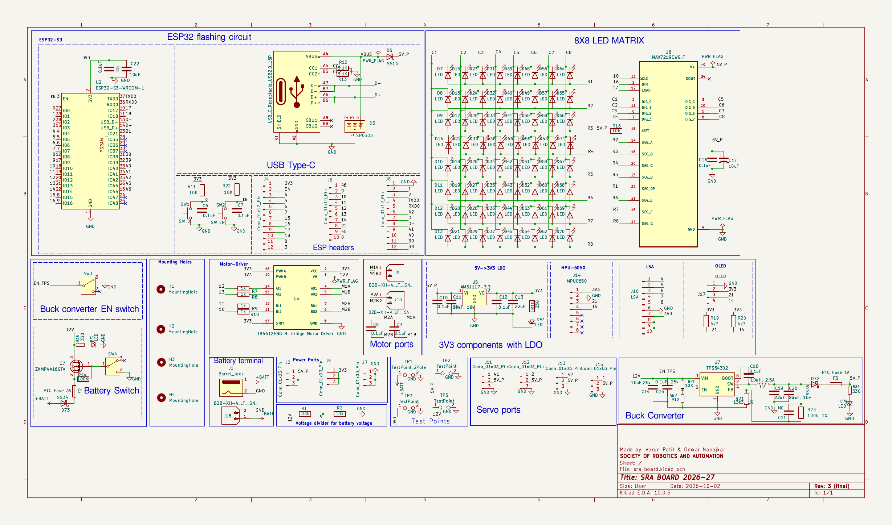

<!-- PROJECT LOGO -->

[![Stargazers][stars-shield]][stars-url]
[![Forks][forks-shield]][forks-url]
[![Issues][issues-shield]][issues-url]
[![License][license-shield]][license-url]

 

  

  <h3 align="center">SRA Development Board</h3>
  

    ESP32-S3 development board and five-channel line sensor array
     
    <a href="./sra_board_2027">KiCAD</a>
    ·
    <a href="./gerbers">Gerber</a>
    ·
    <a href="./documentation/assets/sra_board_2027_front.png">Images</a>
    ·
    <a href="./3d_models/sra_board_2027.step">3D Model</a>
  

# SRA Board 2027

The SRA Board 2027 is an ESP32-S3 development board with a MAX7219-driven 8 × 8 LED matrix, USB-C programming connection, power and motor controls, OLED and MPU-6050 module connections, and a 10-position FFC interface for the separate five-sensor LSA board.

## Table of Contents

- [SRA Board 2027](#sra-board-2027)
  - [Table of Contents](#table-of-contents)
  - [Board Images](#board-images)
  - [About the Project](#about-the-project)
  - [Getting Started with a Development Board](#getting-started-with-a-development-board)
  - [Changes in SRA Board Over the years from 2024-2027](#changes-in-sra-board-over-the-years-from-2024-2027)
  - [Notable problems in the current SRA Board](#notable-problems-in-the-current-sra-board)
  - [Improvements Suggested for Future Iterations](#improvements-suggested-for-future-iterations)
  - [Potential Future Enhancements](#potential-future-enhancements)
  - [3D Models](#3d-models)
  - [Milestones](#milestones)
  - [Contributors](#contributors)
  - [Acknowledgements and Resources](#acknowledgements-and-resources)
  - [License](#license)

## Board Images

- **SRA top / front**

  

- **SRA bottom / back**

  

- **LSA top / front**

  

- **LSA bottom / back**

  

## About the Project

- This development board is designed for SRA robotics projects, including the [Wall-E](https://github.com/SRA-VJTI/Wall-E) platform.
- The editable KiCad sources are in the [SRA project](./sra_board_2027/) and [LSA project](./lsa_board_2027/). Each project includes its schematic, PCB, local symbol and footprint libraries, and BOM.
- The 2027 design was imported from `Wall-E-2027-Board-Design` and replaces the previous 2026 board files in this repository.
- Manufacturing exports are in [Gerbers](./gerbers/), and component datasheets are indexed in [datasheets](./datasheets/README.md).
- Older editions of the board and miscellaneous designs can be found in the [SRA-VJTI PCB Schematics and Layouts repository](https://github.com/SRA-VJTI/PCB-Schematics-and-Layouts).

## Getting Started with a Development Board

  

The SRA controller and LSA are separate boards. Keep the KiCad project folders together with their local libraries and keep `3d_models/components/` alongside them for the referenced component models.

- ### Power Supply Unit
  - The SRA board takes power through a 12 V barrel input. Its power section includes input protection, a TPS54202 5 V buck stage, and an AMS1117-3.3 V regulator.
  - See the [SRA BOM](./sra_board_2027/bom/sra_board_2027.csv) and [datasheet index](./datasheets/README.md) when selecting parts.
  - The LSA connects to the controller through the 10-position FFC interface and is powered from the 3.3 V rail.

- ### Motor Driver
  - The SRA PCB has a footprint for a TB6612FNG H-bridge motor-driver module at `U4`; the module is not an on-board TB6612FNG IC.
  - The board provides two DC motor output channels. Check the motor supply, module pinout, and current limits against the actual motor and module before use.

- ### Sensor Port
  - The separate LSA contains five TCRT5000 reflective sensors, with analog outputs A0–A4.
  - The two boards use a 10-position, 1 mm pitch JUSHUO FFC connector. See the [LSA schematic](./documentation/assets/lsa_schematic_2027.png) and [SRA/LSA BOMs](./sra_board_2027/bom/sra_board_2027.csv) for pin and component details.
  - The SRA also provides module connections for an OLED and an MPU-6050. These are external modules, not components integrated on the PCB.
  - Check cable contact orientation and pin-1 alignment before connecting the boards. The former 7-pin JST LSA wiring is obsolete for this revision.

- ### Protection against [Reverse Voltage](https://www.ti.com/lit/pdf/slva139)
  - The SRA power input uses protection components shown in the schematic and listed in the BOM. The current component datasheet index includes SS14, SS34, and SS54 references.
  - Verify diode polarity and ratings against the schematic before assembly or powering the board.

- ### Protection against [Over Current](https://www.baypower.com/blog/what-is-overcurrent-protection/)
  - The SRA BOM lists resettable PTC fuses for the board power paths, including 3 A and 1 A parts.
  - Confirm each selected fuse's hold and trip current against the actual load and power source.

- ### Programmable Switches and LEDs
  - The board has an 8 × 8 LED matrix driven by a MAX7219, plus status LEDs.
  - Two SPDT slide switches and boot/reset push buttons provide board controls. Their functions are shown in the [schematic](./documentation/assets/sra_schematic_2027.png).

- ### Power Switch
  - The SRA includes two SPDT slide switches in its power/control circuitry. Check the schematic before changing switch positions or wiring.

> The checked-in schematics, PCB layouts, BOMs, and manufacturing files describe the design. They do not establish that a built board has been electrically or mechanically tested.

## Changes in SRA Board Over the years from 2024-2027

|            Feature            |           SRA Board 2024           |           SRA Board 2025           |            SRA Board 2026            |             SRA Board 2027             |
| :---------------------------: | :--------------------------------: | :--------------------------------: | :----------------------------------: | :-----------------------------------: |
|           12V to 5V           |      LM2576-S Buck Converter       |      LM2576-S Buck Converter       |        MP1584 Buck Converter         |         TPS54202 Buck Converter        |
|  Reverse Voltage Protection   |               Diodes               |               Diodes               |                Diodes                |       Diodes |
|   Line Sensing Arrays (LSA)   |             IR Sensors             |             IR Sensors             |              IR Sensors              |       IR Sensors |
|     Number of LSA Sensors     |                 5                  |                 5                  |                  5                   |                   5                    |
|         Motor Driver          |             TB6612FNG              |             TB6612FNG              |              TB6612FNG               |       TB6612FNG        |
|     Stepper Motor Driver      |                 -                  |                 -                  |                  -                   |                   -                    |
|   No. of DC Motor Channels    |                 2                  |                 2                  |                  2                   |                   2                    |
| No. of Stepper Motor Channels |                 0                  |                 0                  |                  0                   |                   0                    |
|        No. of Switches        |                 2                  |                 2                  |                  2                   |       2 slide switches plus buttons     |
|          No. of LEDs          |                 8                  |                 8                  | 6x5 LED Matrix (via Shift Registers) | 8x8 LED Matrix (MAX7219) and status LEDs |
|    Over Current Protection    |        PTC Resettable Fuses        |        PTC Resettable Fuses        |        PTC Resettable Fuses        |          Resettable PTC fuses SMD           |
|     Sensor Port Connectors    |           JST Connectors           |           JST Connectors           |            JST Connectors            |           10-position 1 mm FFC,  JST          |
| Component Type and Board Size | SMD(Surface Mount Device), Smaller | SMD(Surface Mount Device), Smaller |  SMD(Surface Mount Device), Smaller  |       SMD; SRA 90.0 × 70.1 mm            |
|         ESP32 Module          |           Not Integrated           |    Mounted and Soldered to PCB     |     Mounted and Soldered to PCB      |       ESP32-S3-WROOM-1 (`U2`)           |
|         Flashing Port         |             Micro USB              |               Type-C               |                Type-C                |            USB-C USB 2.0                |

- ### **Compatibility of SRA Board with a 12V Supply**
  - The board schematic specifies a 12 V barrel input. Battery suitability depends on pack voltage range, BMS, wiring, motor load, and the assembled board's ratings.
  - Use a correctly rated external BMS for lithium battery packs and verify its cell count, charge limits, current rating, and polarity before connecting a pack.
  - The design files do not constitute battery safety or runtime validation.

- ### **5V Buck Converter and 3.3V Regulation**
  - The 2027 SRA design uses TPS54202 for the 12 V to 5 V buck stage and AMS1117-3.3 for the 5 V to 3.3 V rail.
  - Check component ordering codes, passive values, thermal conditions, and regulator ratings against the [schematic](./documentation/assets/power_stage_schematic_detail.png) and [BOM](./sra_board_2027/bom/sra_board_2027.csv).

- ### **External TB6612FNG Module**
  - The current PCB provides a footprint for a TB6612FNG motor-driver module rather than an integrated TB6612FNG IC.
  - Confirm the module's pin mapping, logic voltage, motor supply, and current limits before connecting motors.

- ### **Component Type and Board Size**:
  - The current design uses SMD parts for much of the circuitry and separate controller and LSA PCBs.
  - The SRA board outline is 90.0 × 70.1 mm and the LSA outline is 61.9 × 24.2 mm, according to the KiCad board files.

- ### **USB-C and Programming**
  - The SRA board includes a USB-C USB 2.0 connection for the ESP32-S3 development interface.
  - Check connector orientation, cable clearance, and mechanical support in the PCB and top/bottom views before fabrication.

- ### **LED System**

  - The 2027 SRA board uses an 8 × 8 LED matrix driven by MAX7219, along with status LEDs.
  - The [schematic detail](./documentation/assets/led_matrix_schematic_detail.png) and [datasheet index](./datasheets/README.md) provide the design and component references.

## Notable problems in the current SRA Board

- ### **KiCad ERC and DRC Findings**
  - The imported 2027 design has unresolved electrical-rule and design-rule findings. Review both project schematics and PCBs in KiCad before fabrication.
  - Regenerate ERC and DRC reports after any change and resolve findings applicable to the intended assembly.

- ### **Schematic, PCB, and BOM Consistency**
  - Review the schematic, PCB, and BOM together. Confirm component values, footprints, connector pin numbering, and assembly options before ordering parts.
  - The SRA and LSA FFC pin names differ between projects; use the numbered pads and schematics to confirm cable orientation.

- ### **3D Model Coverage**
  - Some component models are not available locally, including the FFC connector model. The assembled STEP files and renders may omit those bodies even though the native footprints and fabrication layers include them.

## Improvements Suggested for Future Iterations

Based on the checked-in 2027 design, the following items are useful to review in a future revision:

- **Resolve ERC/DRC Findings**: Review current electrical and layout rule reports and update the design files before treating a revision as fabrication-ready.

- **Complete 3D Model Coverage**: Add verified models for components that are missing from the mechanical assembly, including the FFC connectors.

- **Document Assembly and Power Limits**: Record verified connector orientation, module compatibility, fuse ratings, and supply/load limits alongside the BOM.

- **Record Hardware Validation**: Add test procedures and measured results for power rails, USB programming, motor outputs, the LED matrix, OLED/IMU module interfaces, and LSA channels after a physical prototype is available.

## Potential Future Enhancements

The following ideas are not integrated into the checked-in 2027 design:

- **Onboard IMU Integration**: Replace the external MPU-6050 module connection with a documented, fully integrated IMU circuit if the next revision requires it.

- **Camera FFC/FPC Connector**: Add a dedicated camera interface only after confirming connector pinout, signal requirements, and ESP32-S3 resource availability.

- **Integrated Motor Driver**: Replace the external TB6612FNG module footprint with an on-board driver circuit if thermal and current requirements are established.

- **Additional Interfaces**: Consider debug or expansion connections based on future SRA project requirements.

These enhancements are possible future work and are not features of the current board.

## 3D Models

1. The complete 3D model (.step) files of the [SRA Board 2027](./3d_models/sra_board_2027.step) and [LSA Board 2027](./3d_models/lsa_board_2027.step).
2. Orthographic top and bottom renders for both boards, and local component STEP models, are in [3d_models](./3d_models/README.md).

<!-- Milestone -->

## Milestones

- [x] 2027 SRA and LSA KiCad project files included
- [x] BOM and Gerber exports generated
- [x] SRA and LSA STEP exports included
- [x] Top and bottom renders for both boards included
- [ ] Prototype hardware validation documented

<!-- CONTRIBUTORS -->

## Contributors

- [Varun Patil](https://github.com/varunAPatil/): Designer
- [Omkar Nanajkar](https://github.com/nomkar24) : Designer
- [Vishal Mutha](https://github.com/vishal-mutha) : Mentor
<!-- ACKNOWLEDGEMENTS AND REFERENCES -->

## Acknowledgements and Resources

- Previous editions and miscellaneous designs: [SRA-VJTI PCB Schematics and Layouts](https://github.com/SRA-VJTI/PCB-Schematics-and-Layouts)
- [KiCad Tutorials](https://www.youtube.com/playlist?list=PL3bNyZYHcRSUhUXUt51W6nKvxx2ORvUQB)
- Component documents: [datasheet index](./datasheets/README.md), [Gerber exports](./gerbers/README.md), and [mechanical models](./3d_models/README.md)

## License

- Distributed under the [MIT License](LICENSE).

[forks-shield]: https://img.shields.io/github/forks/SRA-VJTI/sra-board-hardware-design
[forks-url]: https://github.com/SRA-VJTI/sra-board-hardware-design/network/members
[stars-shield]: https://img.shields.io/github/stars/SRA-VJTI/sra-board-hardware-design
[stars-url]: https://github.com/SRA-VJTI/sra-board-hardware-design/stargazers
[issues-shield]: https://img.shields.io/github/issues/SRA-VJTI/sra-board-hardware-design
[issues-url]: https://github.com/SRA-VJTI/sra-board-hardware-design/issues
[license-shield]: https://img.shields.io/github/license/SRA-VJTI/sra-board-hardware-design
[license-url]: https://github.com/SRA-VJTI/sra-board-hardware-design/blob/sra-board-v2.8/LICENSE
